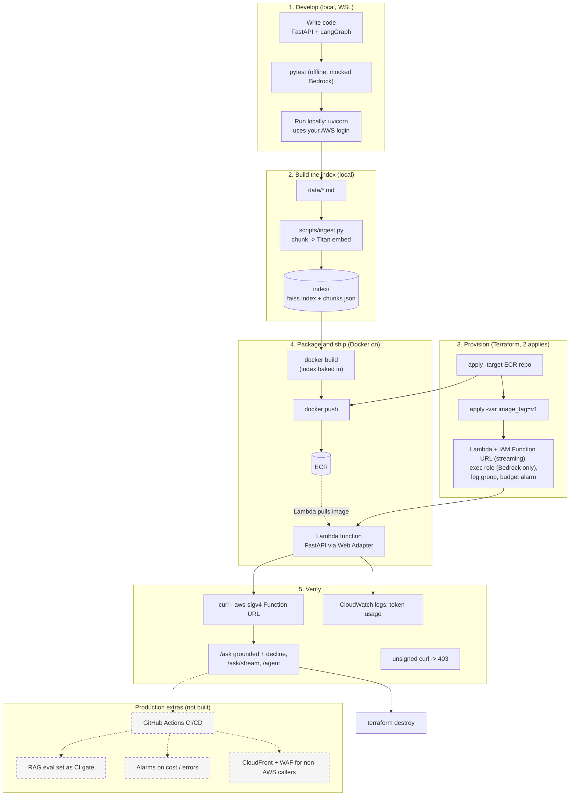
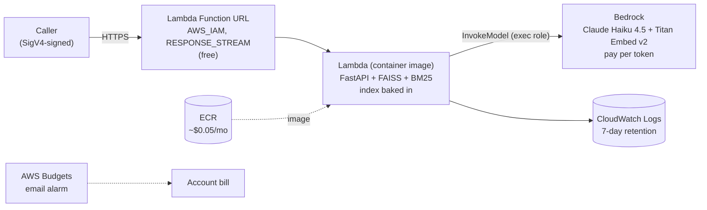
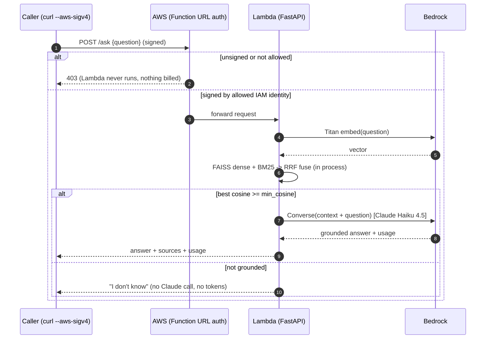
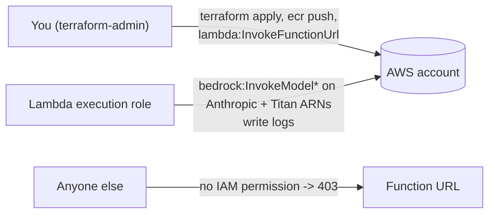

# aws-ai-lab: build, deploy, runtime

Solid boxes = built in this lab. Dashed = what a production team adds.
Bedrock only (Claude Haiku 4.5 + Titan Embed v2). No secrets: IAM role to Bedrock, IAM-signed Function URL for callers.

## 1. Build -> test -> deploy

## 2. Infra at rest (what exists in AWS, and idle cost)

Idle cost: ECR pennies. Lambda, Function URL and logs (within free tier): $0.
No VPC, no NAT gateway, no vector database, no secrets.

## 3. One request (runtime)

## 4. Who can do what (identity map)

## Cheat sheet
| Step | File / command |
| --- | --- |
| Infra | `infra/` -> `terraform apply` (two-step: ECR first, then image) |
| Index | `scripts/ingest.py` (re-run when data changes) |
| Image | `Dockerfile` -> `docker build` / `push` (Docker on) |
| Test | `pytest` (no network), then signed `curl` to the Function URL |
| Teardown | `terraform destroy` |

## Differences from the Azure lab
| Azure | Here |
| --- | --- |
| AOAI + AI Search (idle cost) | Bedrock (pay per token) + local FAISS/BM25 ($0 idle) |
| AKS pod + Workload Identity | Lambda + execution role |
| Key Vault / keyless | no secrets at all (IAM everywhere) |
| Semantic reranker | none (cosine gate instead) |
